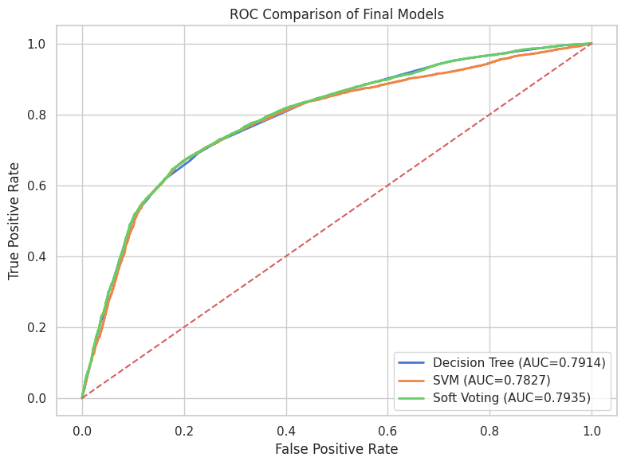

# Cardiovascular Disease Classification

A university team project comparing classical machine-learning models for classifying observed cardiovascular disease status. The pipeline combines data cleaning, exploratory analysis, feature engineering, feature selection, ensemble comparison and SHAP explanations.

**[Open the notebook in Colab](https://colab.research.google.com/github/DarianRobert/Cardiovascular-Disease-Classification/blob/main/notebooks/COMP721_Project.ipynb)** · **[Read the report](report/Cardiovascular_Disease_Report.pdf)**

## Approach

- Clean the 70,000-record dataset, retaining 68,517 records after duplicate and plausibility checks.
- Explore distributions, class balance and relationships between the predictors and the target.
- Add 11 engineered features and use recursive feature elimination to select five predictors.
- Tune a Decision Tree and an SVM with five-fold stratified cross-validation on the training partition.
- Compare Soft Voting with Stacking using aligned validation folds, then evaluate the selected ensemble on the held-out test set.
- Use SHAP for global and individual explanations, and paired-fold tests to assess the ensemble's improvement.

## Reported results

The supplied report uses an 80/20 stratified train/test split: 54,813 training records and 13,704 test records.

| Held-out measure | SVM | Soft Voting |
| --- | --- | --- |
| Accuracy | 73.47% | 73.45% |
| ROC-AUC | 0.7827 | 0.7935 |

Soft Voting achieved an F1-score of **71.81%**. It significantly outperformed the Decision Tree in the paired-fold comparison (p = 0.0040), but its improvement over the SVM was not statistically demonstrated (p = 0.0864).

These figures come from the submitted project report; they have not been independently reproduced for this repository publication. The target records observed disease presence, so this is a status-classification study rather than a prospective clinical risk score.

## Run in Google Colab

1. Download `cardio_train.csv` from the [Cardiovascular Disease dataset on Kaggle](https://www.kaggle.com/datasets/sulianova/cardiovascular-disease-dataset). The dataset is not bundled here.
2. In Google Drive, create `MyDrive/COMP721 Project/data/` and place the CSV there. The original file uses a semicolon separator.
3. Open the notebook using the Colab link above and connect a Python runtime.
4. Install any missing packages from [requirements.txt](requirements.txt), then run the cells in order and authorise the notebook's Google Drive mount.
5. Keep the generated data, model and result folders in the project directory: later cells reuse earlier outputs. SVM fitting and model-agnostic SHAP calculations can take substantial time.

Every `BASE_PATH` points to `/content/drive/MyDrive/COMP721 Project`. Change these together if you use another folder. The notebook uses Colab's `google.colab` module and is not a standalone local script. Package versions from the original run were not supplied; `requirements.txt` records the dependencies, rather than an exact environment lock.

## Repository contents

| Path | Contents |
| --- | --- |
| [notebooks/COMP721_Project.ipynb](notebooks/COMP721_Project.ipynb) | Complete analysis, modelling and explainability notebook |
| [report/Cardiovascular_Disease_Report.pdf](report/Cardiovascular_Disease_Report.pdf) | Compiled final technical report |
| [report/main.tex](report/main.tex) | LaTeX report source |
| [report/figures](report/figures) | Submitted analysis and results figures |
| [data/README.md](data/README.md) | Dataset placement instructions |

For publication, notebook outputs and execution metadata were cleared, shared Drive shortcut paths were replaced with the My Drive path above, and student numbers were removed from the report cover. The modelling code and report findings are preserved. Static notebook validation was performed; model training was not rerun.

To rebuild the report with a LaTeX installation: from `report/`, run `latexmk -pdf -jobname=Cardiovascular_Disease_Report main.tex`.

## Team and my contribution

Developed for **COMP721: Machine Learning**, University of KwaZulu-Natal, 2026, by **Lokadi Naicker, Arjun Ramphal, Keolin Naicker and Darian Robert**.

The report records an equal 25% contribution for each member. **My contribution (Darian Robert): exploratory data analysis, literature review and report writing.** The models and complete pipeline are presented as the team's work.

## Code readability

The notebook uses consistent Python formatting and concise section comments. The original experiment logic, saved outputs and model settings are preserved; formatting has not been used to regenerate the reported results. Colab setup and dataset paths are documented in the notebook.
